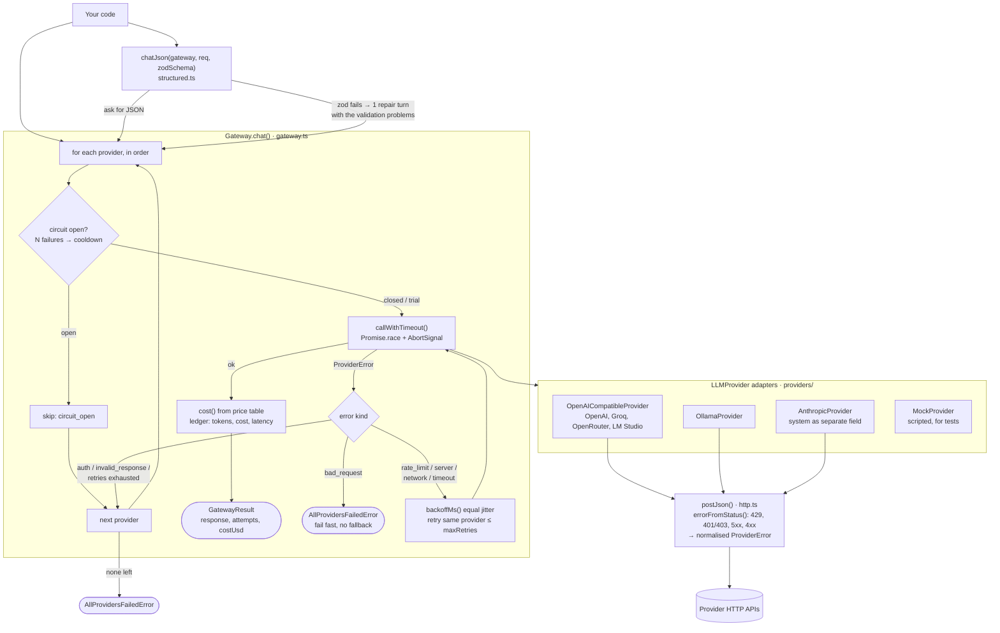

# llm-provider-gateway

One small TypeScript layer between your app and any LLM. Swap providers, survive outages, track
cost, and get validated JSON. Zero runtime dependencies except `zod`.

```
your code -> Gateway -> [ollama] -> retry with jitter -> timeout -> circuit breaker
                     -> [openai-compatible: OpenAI, Groq, OpenRouter, LM Studio ...]
                     -> [anthropic]            ... first healthy provider wins
```

## Architecture



## Why it exists

Provider SDKs differ in wire format, error shape and token accounting. This layer hides all of it
behind `chat(request)`, so changing or adding a provider is a config change.

| Feature | Where | Behaviour |
|---|---|---|
| Adapters | `src/providers/` | OpenAI-compatible (one adapter, many services), Ollama, Anthropic, Mock |
| Normalised errors | `types.ts` | Every failure becomes a `ProviderError` with a `kind` and `retryable` flag |
| Retries | `gateway.ts` | Only rate limits, 5xx, network and timeouts. Equal-jitter exponential backoff |
| Timeouts | `gateway.ts` | Enforced with `Promise.race` and an `AbortSignal`, even if a provider ignores the signal |
| Fallback chain | `gateway.ts` | Auth failures and exhausted retries move to the next provider. Bad requests fail fast |
| Circuit breaker | `gateway.ts` | After N consecutive failures a provider is skipped for a cooldown, then gets one trial |
| Cost and usage | `gateway.ts` | Per-call `costUsd` from your price table, per-provider totals in `report()` |
| Validated JSON | `structured.ts` | `chatJson` checks output with zod and gives the model one repair attempt |

## Use

```ts
import { Gateway, OllamaProvider, OpenAICompatibleProvider, chatJson } from 'llm-provider-gateway';
import { z } from 'zod';

const gateway = new Gateway(
  [
    new OllamaProvider({ model: 'llama3.2' }),
    new OpenAICompatibleProvider({ name: 'groq', baseUrl: 'https://api.groq.com/openai/v1',
      model: 'llama-3.1-8b-instant', apiKey: process.env.GROQ_API_KEY }),
  ],
  { maxRetries: 2, timeoutMs: 20000, breaker: { failureThreshold: 3, cooldownMs: 30000 },
    prices: { 'groq:llama-3.1-8b-instant': { inputPerMTok: 0.05, outputPerMTok: 0.08 } } }, // your numbers
);

const { response, attempts, costUsd } = await gateway.chat({ messages: [{ role: 'user', content: 'hi' }] });

const { data } = await chatJson(gateway, { messages: [{ role: 'user', content: 'Extract: Ada, 36' }] },
  z.object({ name: z.string(), age: z.number() }));
```

## Develop

```bash
npm ci
npm run typecheck && npm test      # 30 tests, no network, no API keys
```

## Live demo

<https://llm-provider-gateway.vercel.app> runs `src/demo.ts` on Vercel with mock providers, so no
model is called and no key is stored. The primary provider rate-limits until its retries run out
and its circuit opens, the fallback answers in prose, and `chatJson` repairs it into validated
JSON. The raw result is at `/api/demo`. Files: `public/index.html`, `api/demo.ts`, `vercel.json`.

## Design decisions

- **One normalised error type.** The gateway only reasons about `kind`, so adding a provider never
  touches retry logic.
- **Bad requests do not fall back.** A 400 is almost always the caller's fault and would fail
  everywhere, so retrying elsewhere only wastes quota.
- **Auth errors are not retried but do fall back.** A bad key on one provider should not take your
  app down while another is healthy.
- **Jitter on backoff** stops many clients retrying at the same instant.
- **Prices are configuration, not code.** They change often and differ per contract, so none are bundled.
  Unknown models report `costUsd: null` instead of a wrong number.
- **Breaker state is per process** and in memory. Share it through Redis if you run many instances.

## Install (free, no registry)

This is a library, so there is nothing to host. Install it straight from GitHub; the `prepare`
script builds `dist/` on install:

```bash
npm install github:JawadulHadi/llm-provider-gateway
```

Publishing to npm later is free for public packages (`npm publish`); `files` already limits the tarball to `dist/`.

## Known limits

- No streaming yet, no tool-calling passthrough, no request cache.
- Anthropic and OpenAI-compatible adapters are tested against faked HTTP, not live APIs. Run
  `examples/ollama-with-fallback.ts` against a real model to check your setup.
- Token counts come from the provider. If a service omits them, usage and cost read as zero.

## Changelog and contributing

Every change adds an entry under **Unreleased** in [`CHANGELOG.md`](CHANGELOG.md) and updates this
README when the API, behaviour or limits change. A CI job fails any pull request that skips the
changelog (label it `skip-changelog` for changes that truly need none). Before opening a PR:

```bash
npm run typecheck && npm test && npm run build
```

See `NOTES.md` for mistakes made and fixed.
